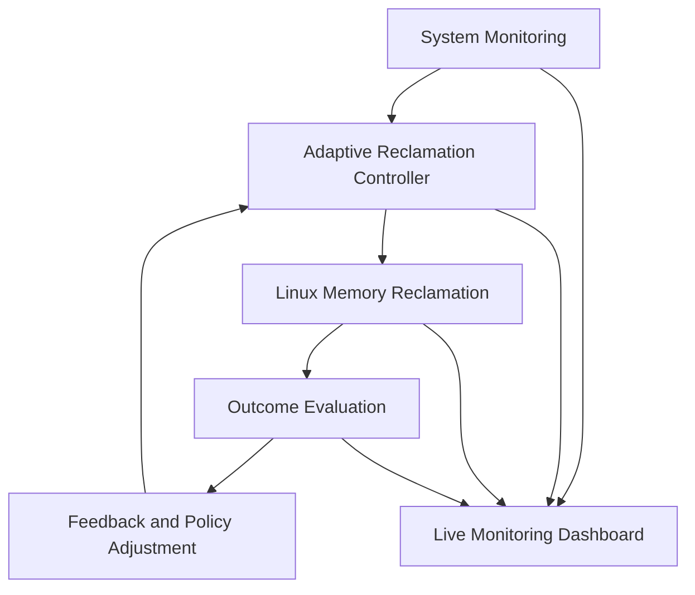
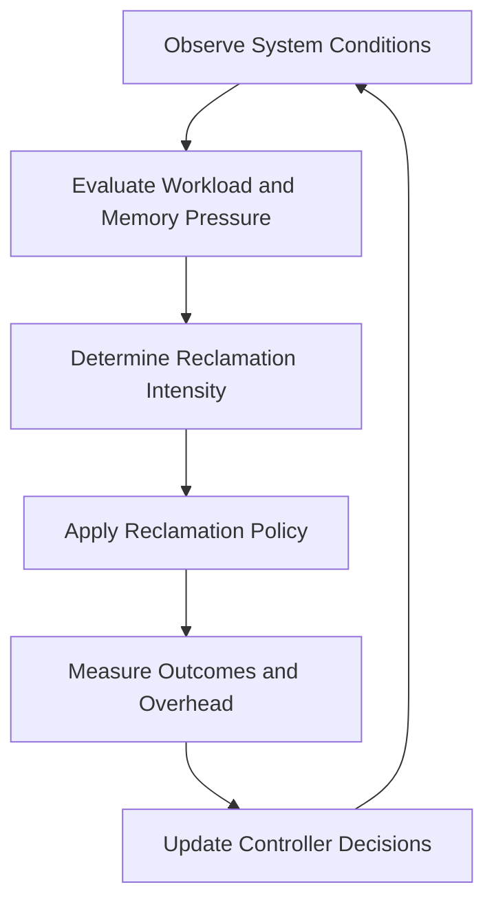

# GhostByte

### Workload-Aware Adaptive Memory Reclamation for Operating Systems

  <strong>Observe. Adapt. Reclaim. Evaluate.</strong>

  
  
  
  

---

## Overview

**GhostByte** is a Linux-based project that explores **workload-aware, feedback-driven memory reclamation**.

Memory is a limited system resource, and the operating system must balance memory availability, application responsiveness, and system overhead. A fixed reclamation strategy may not perform equally well under different workloads.

GhostByte aims to address this challenge through an adaptive controller that continuously monitors memory conditions, adjusts reclamation intensity, evaluates the results of its actions, and uses that feedback to guide subsequent decisions.

The goal is to develop a system that responds to changing workloads rather than relying solely on a fixed reclamation policy.

---

## Project Objectives

- Develop a **feedback-driven memory reclamation controller**.
- Adapt reclamation intensity according to workload behavior and memory pressure.
- Evaluate the effectiveness and cost of reclamation decisions.
- Maintain stable controller behavior as system conditions change.
- Build a **live dashboard** for monitoring memory conditions and controller activity.
- Compare the adaptive approach against a fixed reclamation baseline using repeatable experiments.

---

## System Architecture

GhostByte is organized around four primary components.

### 1. System Monitoring

Collects relevant system information to understand memory conditions and workload behavior.

**Key signals include:**

- Available and used memory
- Memory pressure and resource contention
- Workload and allocation activity
- Reclamation statistics and throughput
- Page refault activity
- Monitoring and reclamation overhead

These signals provide the information required to evaluate the current system state.

### 2. Adaptive Reclamation Controller

The controller is the core of GhostByte.

It evaluates current conditions and the observed consequences of previous reclamation actions to determine an appropriate reclamation intensity.

**Its responsibilities include:**

- Adapting reclamation behavior to changing memory pressure.
- Adjusting intensity within configurable safety limits.
- Evaluating reclamation effectiveness and operational cost.
- Avoiding unnecessary reclamation when it is not beneficial.
- Maintaining stable behavior under fluctuating workloads.

The emphasis is on **continuous feedback and adaptation**, rather than a static policy that remains unchanged across workloads.

### 3. Linux Memory Reclamation Integration

The controller will integrate with a supported Linux memory-management mechanism to perform actual reclamation operations.

The implementation will respect the capabilities, permissions, and constraints of the selected interface.

Reclamation outcomes will be measured to understand how much eligible memory was recovered, how long operations took, and how system performance changed.

### 4. Live Monitoring Dashboard

The dashboard will provide visibility into system memory conditions, controller decisions, and reclamation outcomes.

Planned features include:

| Dashboard Component | Information Displayed |
|---|---|
| **System Overview** | RAM usage, available memory, swap utilization, and memory pressure |
| **Process Explorer** | Process IDs, memory footprints, and relevant workload information |
| **Controller Status** | Current reclamation intensity, controller state, and decision rationale |
| **Reclamation Activity** | Memory reclaimed, operation duration, and observed effectiveness |
| **Performance History** | Trends in memory pressure, reclamation activity, and system performance |

The dashboard will distinguish between processes being monitored and memory that the selected reclamation mechanism can actually manage.

---

## Continuous Feedback Loop

GhostByte follows a continuous **Observe → Decide → Act → Evaluate → Adapt** cycle.

| Stage | Description |
|---|---|
| **Observe** | Collect memory statistics, workload signals, and pressure indicators. |
| **Decide** | Determine an appropriate reclamation intensity using current conditions and previous outcomes. |
| **Act** | Apply the selected policy through the supported Linux reclamation interface. |
| **Evaluate** | Measure reclaimed memory, pressure changes, responsiveness, and operational overhead. |
| **Adapt** | Use observed outcomes to inform subsequent controller decisions. |

This feedback cycle allows the controller to respond to changing workloads and evaluate whether its previous actions were beneficial.

---

## Stability and Safety

An adaptive controller must balance responsiveness with stability.

GhostByte will incorporate appropriate safeguards, including:

- **Bounded control:** Keep reclamation intensity within configured limits.
- **Hysteresis:** Reduce unnecessary switching between operating states.
- **Rate limiting:** Prevent excessive reclamation activity.
- **Outcome monitoring:** Track reclamation effectiveness and overhead.
- **Safe shutdown:** Allow the controller to be stopped or disabled safely.

The implementation will follow Linux memory-management constraints. It will not assume that arbitrary memory belonging to unrelated, live processes can be directly reclaimed.

---

## Evaluation and Benchmarking

GhostByte will be evaluated through repeatable experiments and comparisons against a fixed reclamation baseline.

Testing will cover memory-intensive workloads, file-cache-heavy workloads, and workloads that transition between different levels of memory demand.

### Evaluation Metrics

| Metric | Purpose |
|---|---|
| **Memory Pressure** | Assess memory contention and pressure-related stalls |
| **Reclaimed Memory** | Measure the amount of memory recovered |
| **Application Latency** | Evaluate responsiveness under memory pressure |
| **Page Refault Activity** | Identify potentially counterproductive reclamation |
| **CPU Overhead** | Measure the cost of monitoring and adaptation |
| **Adaptation Time** | Evaluate the response to changing workload conditions |

The goal is not simply to maximize reclaimed memory. Instead, GhostByte will evaluate the trade-offs between memory availability, application responsiveness, and reclamation cost.

Experimental results will be used to determine where the adaptive approach helps, where it introduces overhead, and how it compares with the selected baseline.

---

## Technology and Implementation Direction

The initial implementation will target **Linux**, using supported system interfaces for monitoring and memory reclamation.

The exact technology stack and reclamation mechanism will be finalized after validating the available interfaces, control capabilities, permissions, and measurement options.

Development will proceed incrementally:

1. System monitoring and workload characterization.
2. Adaptive controller design and feedback logic.
3. Integration with an actual Linux reclamation mechanism.
4. Stability safeguards and controller validation.
5. Live dashboard development.
6. Benchmarking, performance analysis, and documentation.

---

## Project Scope

### Included in the Initial Scope

- Feedback-driven memory reclamation
- Workload and memory-pressure monitoring
- Adaptive control and stability safeguards
- Linux memory reclamation integration
- Live monitoring dashboard
- Repeatable experiments and performance benchmarking

### Potential Future Extensions

Depending on the results and feasibility of the initial implementation, future work may explore:

- Deeper kernel integration
- More advanced workload characterization
- Additional adaptive reclamation policies
- Extended performance analytics

**Process scheduling and machine-learning-based control are outside the initial scope.** The priority is to build and evaluate a reliable memory reclamation controller before considering additional subsystems.

---

## Expected Outcome

GhostByte aims to demonstrate how a feedback-driven controller can adapt memory reclamation behavior to changing workloads while making its decisions and performance impact observable.

The intended deliverable consists of:

- A working Linux prototype
- An adaptive memory reclamation controller
- A live system-monitoring dashboard
- Stability and safety mechanisms
- Experimental results comparing the adaptive approach with a fixed baseline

The project's effectiveness will be established through implementation and measured results, rather than assumed performance improvements.

---

## Core Idea

> **Memory reclamation should respond not only to current workload conditions, but also to the measured consequences of previous decisions.**

GhostByte explores how continuous feedback can make memory reclamation more responsive to workload changes while balancing memory availability, application performance, and system overhead.

---

  <strong>GhostByte</strong> 
  <em>Adaptive memory management through continuous feedback.</em>

